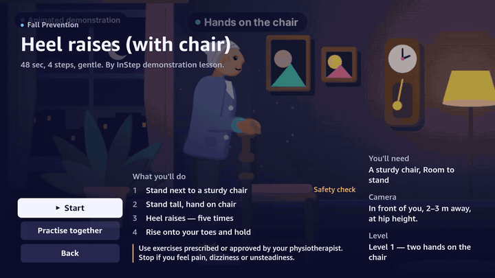
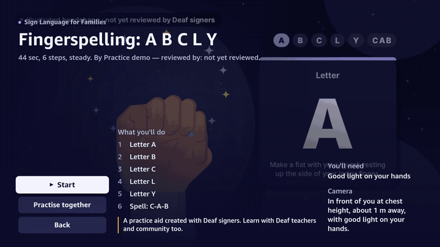
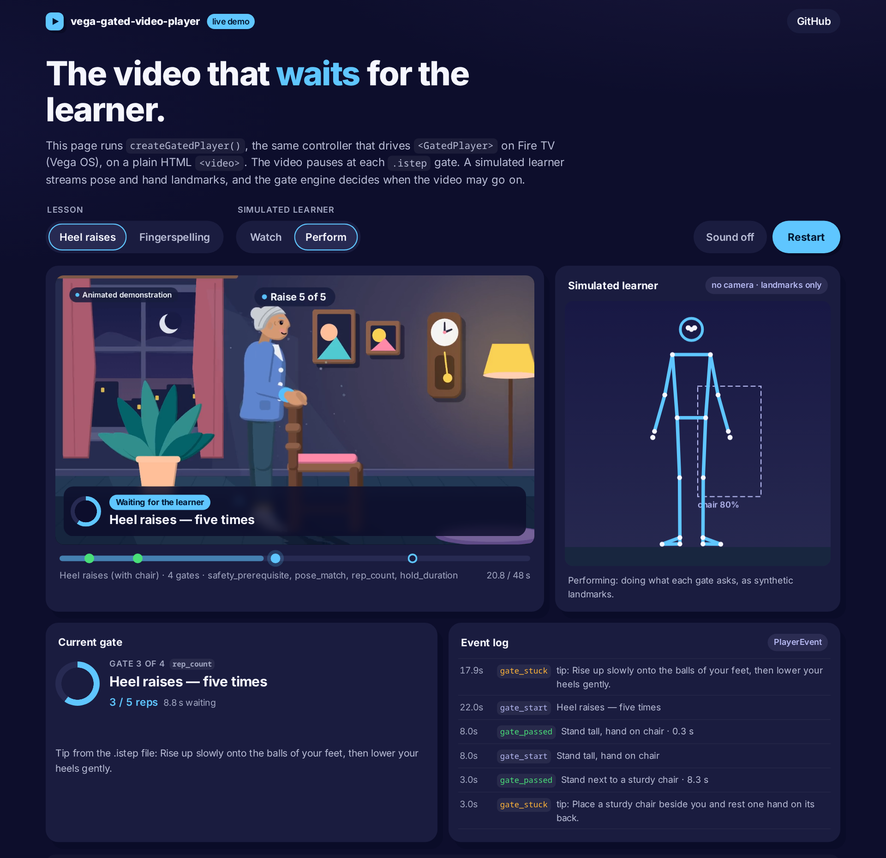
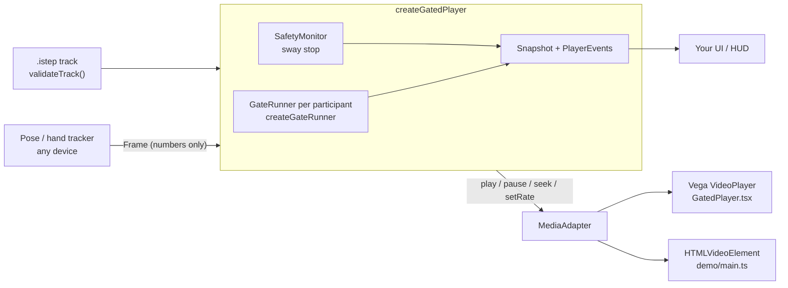
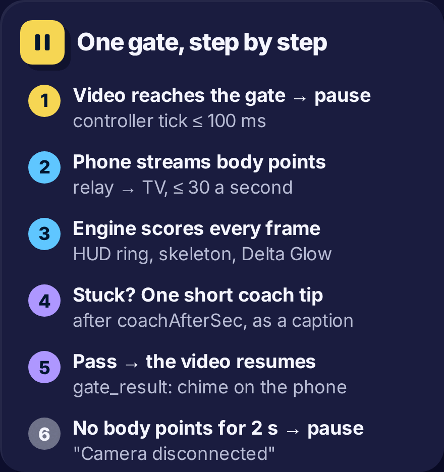

# vega-gated-video-player

**A video player that waits for the learner.** It pauses a lesson video at timed **gates** and resumes when live
pose or hand landmarks pass them. Gates live in `.istep`, an open JSON format for movement (like WebVTT, but for
the body). Built for Fire TV (Vega OS), with a timing controller that runs on any platform.

[](https://github.com/LSUDOKO/vega-gated-video-player/actions/workflows/ci.yml)
[](LICENSE)
[](https://lsudoko.github.io/vega-gated-video-player/)
[](tsconfig.json)

**[Try the live demo →](https://lsudoko.github.io/vega-gated-video-player/)** It runs in the browser, with no
camera. A simulated learner streams landmarks, and you switch it between _watching_ (the video waits) and
_performing_ (the gate passes and the video goes on). (The demo link goes live once GitHub Pages is
enabled with "GitHub Actions" as the source; until then, run it locally with `npm run demo:serve`.)

Extracted from [InStep, the video that waits for you](https://github.com/LSUDOKO/InStep). MIT licensed.

## See it

| On a Vega Virtual Device (InStep TV app)                                                             | On the same device: fingerspelling                                                                                    |
| ---------------------------------------------------------------------------------------------------- | --------------------------------------------------------------------------------------------------------------------- |
|  |  |

Both GIFs are real screen recordings of InStep's TV app on the Vega Virtual Device, which uses this package,
played 3× faster. The learner there is InStep's synthetic learner streaming landmarks over the network (the same
one this repo's web demo uses); the gates, safety checks and rep counts are the real engine.

The web demo, mid-lesson: the video loops the heel-raise segment while the gate counts reps.



## Why

Exercise, rehab and sign-language videos play at their own pace. If you fall behind, the video doesn't notice.
A gated video stops at the moments that matter and goes on only when the learner has actually done the
movement. This package is that loop, kept small and testable:

- **`.istep`**: a declarative file that says _when_ to stop and _what_ to check.
- **A pure TypeScript gate engine** that scores landmark frames against a gate.
- **A timing controller** that pauses, loops, coaches and resumes the media, on any platform.
- **`<GatedPlayer>`** for Vega (React Native for Fire TV).

## Features

- **Seven gate types:** `pose_match`, `hold_duration`, `rep_count`, `rhythm_bpm`, `hand_sign`, `sequence_order`,
  `safety_prerequisite`.
- **Safety first.** `safety_prerequisite` gates use only the thresholds in the file. They are never loosened,
  never skippable, never "learning" gates. An optional lesson-wide **sway stop** pauses the video when lateral sway
  stays above the file's limit, and resuming needs 2 s of stability and an explicit OK.
- **Deterministic adaptive tolerance** for learning gates only: a fixed formula over failed attempts in this
  session and recent passes (`toleranceFactor`, clamped to 0.85–1.3×). No model decides it.
- **Camera-loss handling:** no frames from the host for 2 s → the video pauses; a 3-2-1 countdown resumes it.
- **Loop segments:** a gate can loop the demonstration (`then: "loop_segment"`, muted after the first loop)
  while it waits.
- **Together mode:** several participants; a gate passes when everyone passes within 5 s of each other.
- **Coaching hook:** after `coachAfterSec` the controller emits `gate_stuck` with the latest evaluation, so your
  app can show the file's `fallbackTip` or its own tip.
- **Mirroring, One-Euro smoothing, and auto-gates** generated from an instructor's recorded demonstration.
- **Zod-validated input** with JSON-path errors, plus a JSON Schema in `schema/`.
- **Session summary** at the end: gates passed, reps, best hold, average bpm, sway stops, per-gate attempts.

## Quick start

```bash
npm install github:LSUDOKO/vega-gated-video-player
```

The package ships TypeScript source (`main: src/index.ts`). Metro, esbuild, Vite and vitest compile it directly.
There is no npm release yet; pin a tag with `github:LSUDOKO/vega-gated-video-player#<tag>` once one exists.

### In a Vega app

```tsx
import { GatedPlayer, createFrameStream, validateTrack } from 'vega-gated-video-player/src/react-native';

const frames$ = createFrameStream(); // push MediaPipe-style landmarks from anywhere
const result = validateTrack(json); // a parsed .istep file
if (!result.ok) throw new Error(result.errors.map((e) => `${e.path}: ${e.message}`).join('\n'));

<GatedPlayer
  source={{ uri: 'https://example.com/lesson/video.mp4' }} // Vega plays HTTPS media only
  track={result.value}
  frames$={frames$}
  onGateEvent={(e) => console.log(e.type)}
  onEnd={(summary) => console.log(summary.gatesPassed, '/', summary.gatesTotal)}
  renderOverlay={(state) => <MyHud state={state} />}
/>;

// elsewhere, ~30 times a second:
frames$.push({ ts: Date.now(), mirrored: false, pose: landmarks33 });
```

`example/App.tsx` drives the player with a synthetic landmark stream, no camera needed.

### Anywhere else: the controller

The controller doesn't know about React or Vega. Give it a `MediaAdapter` and call `tick()`. This is the HTML
`<video>` adapter the [web demo](demo/main.ts) uses:

```ts
import { createGatedPlayer, type MediaAdapter } from 'vega-gated-video-player';

const video = document.querySelector('video')!;
const media: MediaAdapter = {
  play: () => void video.play().catch(() => {}),
  pause: () => video.pause(),
  seek: (sec) => (video.currentTime = sec),
  currentTime: () => video.currentTime,
  setRate: (r) => ((video.playbackRate = r), true),
  setMuted: (m) => (video.muted = m),
};

const player = createGatedPlayer({ track, media, now: () => performance.now(), onEvent: console.log });
player.join({ peerId: 'me', role: 'host' });
player.start(); // call from a user gesture (autoplay rules)

setInterval(() => {
  player.pushFrame('me', latestFrame); // from your pose tracker
  player.tick(); // at least every 100 ms
  render(player.snapshot());
}, 33);
```

### Just the engine

```ts
import { createGateRunner, Gate } from 'vega-gated-video-player';

const runner = createGateRunner(Gate.parse(gateJson));
const e = runner.push({ ts: Date.now(), mirrored: false, pose: landmarks33 });
// e → { status: 'waiting' | 'progress' | 'passed' | 'blocked_safety' | 'no_person', progress, score, worst?, reps?, … }
```

## The `.istep` format

A track is one JSON file next to its video. Trimmed from [`examples/fall-heel-raise.istep`](examples/fall-heel-raise.istep):

```jsonc
{
  "istep": "1.0",
  "id": "fall-heel-raise-v1",
  "title": "Heel raises (with chair)",
  "channel": "fall_prevention", // fall_prevention | stroke_rehab | sign_language | cpr | kids
  "language": "en-US",
  "video": { "src": "video.mp4", "durationSec": 48 },
  "tracking": ["pose", "objects"], // which trackers the gates need (validated)
  "camera": { "view": "front", "hint": "Place the camera at hip height, 2–3 m away." },
  "disclaimer": "Use exercises prescribed or approved by your physiotherapist. …", // required for health channels
  "safety": { "swayStop": { "enabled": true, "maxLateralSway": 0.06, "windowSec": 1.5 } },
  "defaults": { "tolerance": { "angleDeg": 20 }, "coachAfterSec": 6, "timeoutSec": 45 },
  "gates": [
    {
      "id": "chair",
      "t": 3, // the video pauses here
      "type": "safety_prerequisite",
      "label": "Stand next to a sturdy chair",
      "checks": [
        { "kind": "object_near", "object": "chair", "near": "hips", "maxDistance": 0.35, "minScore": 0.5 },
        { "kind": "full_body_visible" },
        { "kind": "stable", "maxLateralSway": 0.04, "windowSec": 1 },
      ],
      "fallbackTip": "Place a sturdy chair beside you and rest one hand on its back.",
    },
    {
      "id": "raises",
      "t": 22,
      "type": "rep_count",
      "label": "Heel raises — five times",
      "metric": { "kind": "heel_lift" },
      "range": { "low": 0.02, "high": 0.06 }, // LOW → HIGH → LOW is one rep
      "reps": 5,
      "rewindTo": 12,
      "then": "loop_segment", // loop 12 s → 22 s while waiting
      "fallbackTip": "Rise up slowly onto the balls of your feet, then lower your heels gently.",
    },
  ],
}
```

Every gate has `id`, `t`, `type`, `label` and `fallbackTip`. It can also set `tolerance`, `coachAfterSec`,
`timeoutSec`, `learning`, `rewindTo` and `then` (`resume` | `loop_segment`). The validator also checks that gates
are sorted by `t`, ids are unique, `t` is within the video, `loop_segment` has `rewindTo`, the needed trackers
are listed, and health channels carry a disclaimer.

| Gate type             | Passes when                                                                                                                                                                                                                         |
| --------------------- | ----------------------------------------------------------------------------------------------------------------------------------------------------------------------------------------------------------------------------------- |
| `pose_match`          | Listed `joints` are within `tolerance.angleDeg` of a target (fixed `angles`, or the reference pose at `atSec`) for `minFrames` consecutive frames. Optional `conditions`: `heel_lift`, `foot_lift`.                                 |
| `hold_duration`       | The same match is held for `holdSec`. Gaps up to `graceSec` pause the timer; longer gaps reset it.                                                                                                                                  |
| `rep_count`           | `reps` full repetitions of a `metric` (`joint_angle`, `hand_openness`, `wrist_rotation`, `vertical_position`, `heel_lift`): LOW → HIGH → LOW across `range`. Optional `paceFollow` suggests a slower playback rate (1, 0.75, 0.5×). |
| `rhythm_bpm`          | `count` presses of a landmark `signal` within `bpm.min`–`bpm.max`, and with straight arms if `armsStraight.minElbowDeg` is set.                                                                                                     |
| `hand_sign`           | Finger curls (0 = extended, 1 = curled; thumb → pinky) are within `tolerance.curl` of the target, plus optional thumb–index `spread`, on the chosen `hand` (`left`, `right`, `affected`, `any`).                                    |
| `sequence_order`      | 2–12 `steps` (`hand_sign` or `pose_match`) done in order. Only the current step is evaluated, so out-of-order shapes never advance.                                                                                                 |
| `safety_prerequisite` | Every check (`object_near`, `full_body_visible`, `upper_body_visible`, `hands_visible`, `stable`) passes on the same frame for `minFrames` frames. Fixed thresholds; can't be skipped or loosened.                                  |

Seven complete tracks are in [`examples/`](examples/): balance, rehab, fingerspelling, a first sign, CPR rhythm and
a kids' story. The JSON Schema is [`schema/istep-1.0.schema.json`](schema/istep-1.0.schema.json). Media type:
`application/vnd.instep+json` (`ISTEP_MIME`).

## API reference

Everything is exported from `src/index.ts`. `src/react-native.ts` re-exports it and adds the Vega component.

### Format: `src/istep`

| Export                                       | What it does                                                                                                      |
| -------------------------------------------- | ----------------------------------------------------------------------------------------------------------------- |
| `validateTrack(input)`                       | Validates parsed JSON. Returns `{ ok: true, value: IstepTrack }` or `{ ok: false, errors: { path, message }[] }`. |
| `validateTrackText(text)`                    | Same, from a JSON string (reports JSON syntax errors too).                                                        |
| `validateReference(input)`                   | Validates an instructor landmark timeline (`ReferenceTimeline`).                                                  |
| `effectiveGateSettings(track, gate)`         | `coachAfterSec`, `timeoutSec`, `learning` and `tolerance` after applying track defaults.                          |
| `IstepTrack`, `Gate`, `ReferenceTimeline`, … | Zod schemas (and the inferred TypeScript types of the same name).                                                 |

### Engine: `src/engine`

| Export                                                               | What it does                                                                                                                                              |
| -------------------------------------------------------------------- | --------------------------------------------------------------------------------------------------------------------------------------------------------- |
| `createGateRunner(gate, ctx?)`                                       | Stateful scorer for one gate. `push(frame)` → `GateEval`; `reset()`. `ctx`: `tolerance`, `reference`, `affectedHand`, `smoothing` (One-Euro, default on). |
| `createSafetyMonitor(swayStop)`                                      | Lesson-wide sway monitor: `push(frame)` → `{ stop, sway, stableMs }`; `isStableForResume()`.                                                              |
| `toleranceFactor(history)`, `nextTolerance(base, history, learning)` | The deterministic adaptive tolerance. `nextTolerance` returns `base` unchanged when `learning` is false.                                                  |
| `autoGates({ reference, channel, durationSec })`                     | Proposes gates from a recorded demonstration (still moments and repeating motion).                                                                        |
| `POSE_EDGES`, `HAND_EDGES`                                           | Skeleton edges for drawing landmarks.                                                                                                                     |
| `src/engine/fixtures`                                                | `makePose`, `makeHand`, `chair`, `stream`: synthetic landmarks for tests and demos.                                                                       |

A `Frame` is `{ ts, mirrored, pose?, hands?: { left?, right? }, handScores?, objects? }`. `pose` holds 33 MediaPipe
Pose landmarks and each hand 21 MediaPipe Hand landmarks, all `{ x, y, z, v? }` normalised to 0–1.

### Player: `src/player`

`createGatedPlayer(options)`:

| Option         | Type                       |                                                                                                             |
| -------------- | -------------------------- | ----------------------------------------------------------------------------------------------------------- |
| `track`        | `IstepTrack`               | required                                                                                                    |
| `media`        | `MediaAdapter`             | required: `play()`, `pause()`, `seek(sec)`, `currentTime()`, optional `setRate(r) → boolean`, `setMuted(m)` |
| `now`          | `() => number`             | required: the clock in ms (use the same clock as frame `ts`)                                                |
| `onEvent`      | `(e: PlayerEvent) => void` | optional                                                                                                    |
| `reference`    | `ReferenceTimeline`        | optional, for `source: "reference"` targets                                                                 |
| `affectedHand` | `'left' \| 'right'`        | optional, resolves `hand: "affected"`                                                                       |
| `recentPasses` | `Record<string, number>`   | optional: passes per gate type in recent sessions (adaptive tolerance)                                      |

It returns:

| Method                     | What it does                                                                                                                                           |
| -------------------------- | ------------------------------------------------------------------------------------------------------------------------------------------------------ |
| `start()`                  | Seeks to 0 and plays.                                                                                                                                  |
| `join(p)` / `leave(id)`    | Adds or removes a participant `{ peerId, role: 'host' \| 'guest', name? }`. Camera loss follows the host.                                              |
| `pushFrame(peerId, frame)` | Feeds one landmark frame.                                                                                                                              |
| `tick()`                   | Advances timing. Call at least every 100 ms.                                                                                                           |
| `snapshot()`               | `Snapshot`: `phase`, `gate`, `gateIndex`, `evals` per participant, `gateSec`, `canSkip`, `easier`, `playbackRate`, `countdownMs`, `stableForResume`, … |
| `control(action)`          | `'toggle_pause' \| 'play' \| 'pause' \| 'repeat' \| 'easier' \| 'next' \| 'ok'`. `next` works only after `timeoutSec` and never on safety gates.       |
| `end()`                    | Ends the lesson and returns the `SessionSummary`.                                                                                                      |

`Phase`: `ready` · `playing` · `gate` · `passing` · `paused` · `safety_stop` · `camera_lost` · `ended`.

`PlayerEvent`:

| `type`         | Payload                                                                |
| -------------- | ---------------------------------------------------------------------- |
| `gate_start`   | `gate`                                                                 |
| `gate_passed`  | `gate`, `ms` (time to pass)                                            |
| `gate_stuck`   | `gate`, `eval`, `attempts` (after `coachAfterSec`, then every 2× that) |
| `gate_skipped` | `gate`                                                                 |
| `safety_stop`  | `reason: 'sway'`, `peerId`                                             |
| `camera_lost`  | none                                                                   |
| `resumed`      | `from: Phase`                                                          |
| `ended`        | `summary: SessionSummary`                                              |

### `<GatedPlayer>` (Vega): `src/player/GatedPlayer.tsx`

| Prop            | Type                                    |                                                                           |
| --------------- | --------------------------------------- | ------------------------------------------------------------------------- |
| `source`        | `{ uri: string }`                       | HTTPS video URL                                                           |
| `track`         | `IstepTrack`                            |                                                                           |
| `frames$`       | `FrameStream`                           | from `createFrameStream()` (`push(frame, peer?)`) or your own `subscribe` |
| `reference`     | `ReferenceTimeline`                     | optional                                                                  |
| `onGateEvent`   | `(e: PlayerEvent) => void`              | optional                                                                  |
| `onEnd`         | `(summary: SessionSummary) => void`     | optional                                                                  |
| `renderOverlay` | `(state: Snapshot) => ReactNode`        | optional, drawn over the video                                            |
| `controllerRef` | `MutableRefObject<GatedPlayer \| null>` | optional, for remote keys (`control(...)`)                                |
| `options`       | `{ affectedHand?, tickMs? }`            | `tickMs` defaults to 50                                                   |
| `style`         | `ViewStyle`                             | optional                                                                  |

It uses the W3C media `VideoPlayer` from `@amazon-devices/react-native-w3cmedia` on a `KeplerVideoSurfaceView`
(optional peer dependencies, needed only for this component).

## Architecture



1. While `playing`, `tick()` watches `media.currentTime()`. At a gate's `t` it pauses, seeks to `t`, emits
   `gate_start` and creates a fresh `GateRunner` per participant (looping `rewindTo → t` if asked).
2. Each `pushFrame()` runs the sway monitor, then the runner: mirror normalisation, One-Euro smoothing, scoring.
3. When every participant has passed, `gate_passed` fires, the phase is `passing` for 400 ms, then playback resumes.
4. Stuck for `coachAfterSec`: `gate_stuck` fires, and learning gates get a slightly wider tolerance next attempt.
5. No host frames for 2 s: `camera_lost` and pause, whatever the phase. Frames are back: a 3 s countdown, then resume.



In InStep the frames come from a phone over a WebSocket relay, the TV runs `<GatedPlayer>`, and the HUD and coach
tips are InStep's own. None of that is in this package.

## Vega notes

- **HTTPS media only.** The Vega media player refuses `http://` video sources; serve lesson videos over HTTPS with a
  publicly trusted certificate.
- **Babel for RN 0.72.** This code and zod 4 use newer syntax (`??=`, `||=`, class static blocks). With the RN 0.72
  Vega template, add `@babel/plugin-transform-logical-assignment-operators` and
  `@babel/plugin-transform-class-static-block` to `babel.config.js`.
- **TypeScript source.** Metro transpiles it; there is no separate build step.
- Video: H.264 MP4 plays through the W3C media `VideoPlayer` in InStep's TV app.

## Privacy

The player consumes numbers only: normalised landmark coordinates and optional object boxes. It never needs or
touches camera images, and it makes no network requests of its own (the only fetch is the video `source` you give
`<GatedPlayer>`). Where frames come from, and whether they leave a device,
is up to your app. The web demo has no camera and sends nothing.

## Develop and test

```bash
npm install
npm test            # vitest: format, engine, controller and the web demo's learner
npm run typecheck   # strict TypeScript: the package, then the demo
npm run demo:serve  # builds demo/dist and serves demo/ on http://localhost:8080 (with byte ranges for seeking)
```

`demo/sim.test.ts` checks the demo's promise through the real controller: a watching learner never passes any gate
of either lesson, and a performing learner passes all of them and reaches `ended`. The web demo deploys to GitHub
Pages from `.github/workflows/pages.yml`.

This repository is generated from the [InStep monorepo](https://github.com/LSUDOKO/InStep) by
`scripts/export-oss.mjs`. Pull requests here are welcome; accepted changes are carried back to the monorepo.

## Roadmap

- A tagged release and an npm package with compiled JavaScript, so plain Node can import it without a TS loader.
- An opt-in camera mode for the web demo (browser pose tracking, frames stay in the browser).
- More example tracks, and handshape lessons reviewed by Deaf signers.

Ideas and requests: [open an issue](https://github.com/LSUDOKO/vega-gated-video-player/issues).

## Used by

- **[InStep](https://github.com/LSUDOKO/InStep)**: guided movement lessons on Fire TV. A phone tracks the learner,
  the TV video waits at each gate. Fall prevention, stroke rehab, sign language for families, CPR rhythm practice
  and a kids' story.

Using it somewhere? A pull request adding a line here is welcome.

## Contributing

See [CONTRIBUTING.md](CONTRIBUTING.md) and the [Code of Conduct](CODE_OF_CONDUCT.md). Security issues:
[SECURITY.md](SECURITY.md). Changes: [CHANGELOG.md](CHANGELOG.md).

## License and credits

Code: [MIT](LICENSE) © 2026 Arpit Singh ([LSUDOKO](https://github.com/LSUDOKO)).

- The lesson videos in `demo/media/` and the `.istep` tracks are InStep's own demonstration lessons: illustrated
  animations drawn in code, no real person, CC-BY-4.0. The fingerspelling handshapes are illustrated and **not yet
  reviewed by Deaf signers**. Narration is a synthetic Kokoro-82M voice. Full credits:
  [InStep's CREDITS.md](https://github.com/LSUDOKO/InStep/blob/main/content/CREDITS.md).
- Landmark layouts follow MediaPipe Pose (33 points) and MediaPipe Hands (21 points).
- The health lessons are practice aids, not medical advice. Use exercises prescribed or approved by your
  physiotherapist. Stop if you feel pain, dizziness or unsteadiness.
